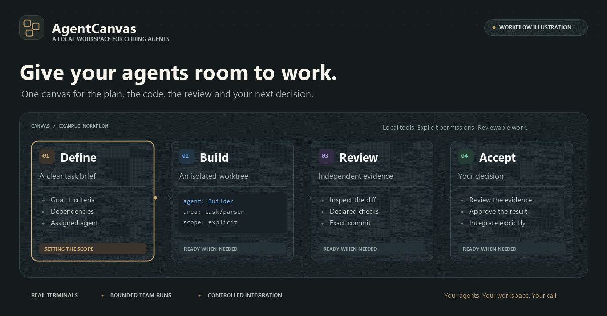

<p align="center">
  
</p>

<h1 align="center">AgentCanvas</h1>

<p align="center">
  <strong>A spatial workspace for your coding agents.</strong><br />
  Bring terminals, tasks, notes and review together. Keep the next decision in your hands.
</p>

<p align="center">
  <code>WINDOWS x64</code> &nbsp; <code>CODEX + CLAUDE CODE</code> &nbsp; <code>LOCAL WORKSPACES</code> &nbsp; <code>NO TELEMETRY</code>
</p>

<p align="center">
  <a href="#quickstart">Quickstart</a> &nbsp;·&nbsp;
  <a href="#features">Features</a> &nbsp;·&nbsp;
  <a href="#roadmap">Roadmap to M28</a> &nbsp;·&nbsp;
  <a href="#development">Development</a> &nbsp;·&nbsp;
  <a href="#guides">Guides</a>
</p>

<p align="center">
  
</p>

<p align="center">
  <sub>An illustrated workflow, from a clear brief to your next decision. <a href="docs/assets/readme/workflow.png">View the still image</a>.</sub>
</p>

> **Development status:** M0–M11 are implemented. Current desktop and editor packages target **Windows x64**; Linux and macOS are planned. The mixed-team native fixture is fixed and native checks pass; VSIX v0.1.4 adds backend restart recovery. Deeper UI, provider and release qualification remain open. See [project status](docs/PROJECT-STATUS.md) and [executed verification](docs/VERIFICATION.md).

## Features

| Your workspace               | What it gives you                                                                                                                                                   |
| ---------------------------- | ------------------------------------------------------------------------------------------------------------------------------------------------------------------- |
| **A spatial canvas**         | Arrange, connect, resize and navigate terminals, agents, notes and whiteboards. Use zoom, the minimap and layout undo/redo to keep work in view.                    |
| **Real agent terminals**     | Launch your installed Codex and Claude Code CLIs with reusable roles and per-node launch snapshots. Preserve their own authentication and approval settings.        |
| **Durable tasks**            | Capture briefs, acceptance criteria, dependencies and attempts. Track acknowledgement, progress, review and blocked work through a structured cooperative protocol. |
| **Isolated Git areas**       | Give changes their own managed worktrees. Inspect diffs and commit-bound evidence before explicit approval and integration.                                         |
| **Bounded team runs**        | Adopt a plan, assign agents and choose manual or scoped automatic dispatch. Control concurrency, retries, elapsed time, pause and emergency stop.                   |
| **Shared project context**   | Connect file-backed Markdown notes to agents and use the whiteboard for diagrams, annotations and visual connections.                                               |
| **Two Windows hosts**        | Work in the standalone Tauri desktop app or a local VS Code / Antigravity editor tab backed by the same React canvas and Rust core.                                 |
| **Explicit browser actions** | Use restricted embedded browser nodes on desktop. Editor browser nodes open your default browser after a click. Agent browser automation is planned work.           |

## Quickstart

Build from source on **Windows x64**. You need Node 22 LTS, Rust stable MSVC, Visual Studio C++ build tools with the Windows SDK, and the WebView2 Evergreen Runtime.

Install the project dependencies and Tauri CLI from a Git checkout:

```powershell
npm ci
cargo install tauri-cli --version '^2' --locked
```

### Desktop app

```powershell
npm run desktop
```

Choose a workspace, add a terminal or agent, and start arranging your canvas. Install and sign in to provider CLIs separately; executable detection does not verify authentication.

### VS Code or Antigravity

```powershell
npm run extension:package
```

1. Run **Extensions: Install from VSIX...** in your editor.
2. Select `artifacts/agentcanvas-0.1.4-win32-x64.vsix`.
3. Open a trusted local project and run **AgentCanvas: Open Canvas**.
4. Follow the setup guide, or finish with terminals, notes and the whiteboard.

The installed extension bundles its native backend and helpers; it does not need Rust, Node or the standalone desktop app on the destination machine. See the [editor guide](extension/README.md) for project selection, setup and draft recovery.

## From a brief to an accepted change

1. **Set the scope.** Pick the project and create a task with a brief, criteria and dependencies.
2. **Give it a workspace.** Create a managed Git area, assign the task and start the selected agent.
3. **Dispatch deliberately.** Use the cooperative inbox and explicitly brief the agent to query it. Team runs can dispatch to existing live agents within adopted permissions and limits.
4. **Review the evidence.** Inspect the exact commit, independent review and declared checks. A provider response alone does not establish completion.
5. **Make the call.** Accept the result and explicitly approve/integrate the reviewed changes. Pause, cancel or reconcile uncertain work when needed.

The [task protocol](docs/M9-PROTOCOL.md), [Git area guide](src/areas/README.md) and [team protocol](docs/M11-TEAM-PROTOCOL.md) describe the current boundaries.

## Local state, explicit control

- **Local workspace files:** versioned atomic saves, conflict checks, preserved corrupt originals and last-good backups.
- **Session-only terminal data:** terminal output, command history, credentials, tokens and process handles are excluded from workspace saves. Reopened agent nodes stay paused.
- **Scoped authority:** peer connections and model output cannot grant permissions or accept their own work. Git worktrees isolate code; they are not an OS sandbox.
- **Separate provider policies:** AgentCanvas adds no account or telemetry. Installed provider CLIs retain their own authentication, network and data-retention behavior.

## Roadmap

Windows is the current implementation target. Linux and macOS are part of the planned product, with their own native lifecycle, packaging and acceptance work.

| Milestone   | Direction                                                                                                          | Status                             |
| ----------- | ------------------------------------------------------------------------------------------------------------------ | ---------------------------------- |
| **M0–M11**  | Canvas, terminals, persistence, notes, links, agents, tasks, Git isolation and bounded teams                       | Implemented; qualification remains |
| **M12**     | Reusable templates, project context, scoped browser tools and guided workflows                                     | Planned                            |
| **M13**     | Portable native runtime, Unix IPC and process ownership                                                            | Planned                            |
| **M14**     | Linux desktop and installable packages                                                                             | Planned                            |
| **M15**     | macOS desktop and signed/notarized distribution                                                                    | Planned                            |
| **M16–M17** | Linux/macOS editor extensions and a qualified three-platform beta                                                  | Planned                            |
| **M18–M24** | Structured conversations, project knowledge, visual workflows, Git delivery, archives, tools and reusable packages | Planned                            |
| **M25–M27** | Optional remote/container execution, shared workspaces, selective sync and schedules                               | Planned                            |
| **M28**     | Stable cross-platform release qualification                                                                        | Planned                            |

Read the [full M12–M28 roadmap](docs/MILESTONES.md) for dependencies, deliverables and acceptance gates, and the [status tracker](docs/PROJECT-STATUS.md) for current blockers. Roadmap entries describe future work; they do not imply shipped compatibility or committed dates.

## Development

Tauri 2 · Rust · React · TypeScript · Vite · Zustand · xterm.js

| Command                     | Purpose                                                                |
| --------------------------- | ---------------------------------------------------------------------- |
| `npm run dev`               | Browser UI development; native terminals require a desktop/editor host |
| `npm run desktop`           | Start the native desktop development app                               |
| `npm run check`             | Formatting, lint, frontend types/tests/build and extension checks      |
| `npm run native:check`      | Rust formatting, Clippy and native tests                               |
| `npm run desktop:build`     | Build the optimized portable Windows app, ZIP, manifest and checksums  |
| `npm run desktop:release`   | Build portable artifacts plus NSIS and MSI installers                  |
| `npm run extension:build`   | Build the editor extension and bundled native backend                  |
| `npm run extension:package` | Create the Windows VSIX                                                |
| `npm run extension:check`   | Check extension types, bridge tests and the available bundled sidecar  |

<details>
<summary><strong>Portable builds, installers and development-host notes</strong></summary>

For a debug portable build:

```powershell
npm run desktop:build -- --debug
.\artifacts\windows-debug\agent-canvas-desktop.exe
```

Debug builds may show a console alongside the canvas window. `npm run desktop:build` creates the optimized build in `artifacts/windows-portable/`, plus a ZIP, manifest and SHA-256 checksums. Keep `agent-canvas-desktop.exe`, `pty-host.exe` and `agentcanvas-peer.exe` together. The scripts build all three binaries in the same profile and derive the display name from `product.json`. Source build outputs remain under `src-tauri/target/`. The build script also supports the official Tauri CLI installed under `.tools/tauri/` on this development host.

Run `npm run desktop:release` to build the portable release and NSIS/MSI installers in `artifacts/windows-installers/`. NSIS installs for the current user; MSI uses Windows Installer. Both include the two helper executables. Packages require the WebView2 Evergreen Runtime to be installed already and do not download it during installation. Builds are unsigned unless signing is configured separately. Set `AGENTCANVAS_BUILD_TAG=m7` to stage a separate set of milestone artifacts.

The optional Git Bash roundtrip test needs an unrestricted Windows host with Git Bash installed. Run it explicitly with `cargo test --manifest-path src-tauri/Cargo.toml --locked --test conpty -- --ignored`; Windows CI also runs it separately. The restricted agent host cannot create MSYS2 signal pipes, although the user-launched application's Git Bash prompt has been visually verified.

On this restricted development host, use `$env:CANVAS_NO_SUBPROCESS='1'` in PowerShell before `npm run check` to enable the documented in-process compiler fallback. This is a verification aid; it does not provide a native runtime. See [third-party dependency provenance](THIRD_PARTY.md) for the offline xterm dependency constraints.

Formatting commands expect a Git checkout. They check tracked and non-ignored new source files without walking generated caches or build outputs.

README artwork is stored in the repository and uses no remote image/font service. Regenerate the GIF and still image on Windows with `powershell.exe -NoProfile -File scripts/readme-media.ps1`; the generator uses built-in .NET drawing/encoding assemblies.

</details>

## Guides

The details below cover the behavior and limits behind the feature overview.

<details>
<summary><strong>Workspaces, autosave and restart recovery</strong></summary>

Workspaces autosave after 750 ms and flush before switching or closing. Use the workspace button in the sidebar to create a named workspace, switch recent workspaces, or open an existing folder. Each folder contains a versioned `workspace.json`, a previous-save backup, and a `notes/` folder. The recent-workspace catalog is stored in the application's local data directory. `AGENTCANVAS_DATA_DIR` overrides that directory for isolated development runs.

On relaunch, the last workspace restores its canvas and starts fresh shells in their saved startup directories. Commands, terminal output and undo history are session-only. Missing directories remain visible as failed terminal nodes; select one and use Restart to correct its directory. Save failures pause autosave and remain visible; a failed save prevents a normal switch or close. Truncated layouts can recover from their backup, while unsupported schemas and external edits are preserved and reported.

</details>

<details>
<summary><strong>Agent presets, roles and launch settings</strong></summary>

Select **Agent presets** in the sidebar to create reusable roles and Codex/Claude Code launch presets. Builder, Reviewer and Tester roles are provided initially. The app detects installed native CLIs; an optional absolute `codex.exe` or `claude.exe` path supports custom locations. Install and sign in to each CLI separately. Detection confirms an executable exists; it does not check authentication or version compatibility.

Select **+ Agent**, choose a preset, and set the agent name and working directory. You can adjust its role instructions and executable for this node before starting. Launches use a real ConPTY and preserve the installed CLI's authentication and approval configuration. No task is submitted automatically. Role instructions are supplied as session arguments, without editing the project's instructions files.

Agent nodes save a copy of their launch settings. Editing or deleting a library preset does not change existing nodes. Reopened agents stay paused; select **Start agent** in the node to launch, or **Edit launch settings** in the inspector to change settings first. Failed or exited agents can be restarted through the inspector. Layout undo does not roll launch settings back after a restart. CLI output, input, credentials and process handles are not included in workspace saves.

The reusable library is `agents.json` in the local app data directory, with a last-good backup and conflict detection. A corrupt primary can recover from its backup; saving archives the corrupt original. **Reload from disk** discards the editor draft, so copy any changes you want to retain before reloading. Instructions are limited to 4096 UTF-8 bytes, and the library supports 32 roles and 32 presets. Task scheduling, Git isolation and bounded team coordination are supplied by M9–M11.

</details>

<details>
<summary><strong>Durable tasks and cooperative dispatch</strong></summary>

Open **Tasks** to create a brief, acceptance criteria, dependencies and a terminal/agent assignment. Save the draft, mark it ready, start the assigned terminal explicitly, then dispatch to its cooperative inbox. Dispatch does not type into the CLI. Prompt your installed agent to query its inbox using `agentcanvas-peer task <request-UUID> --stdin`; new agent launches include protocol guidance. Agent reports move a task to Review; **Accept result** marks it done.

Tasks save independently in `tasks.json` with atomic replacement, validation, deduplicated mutation receipts and a last-good backup. Attempts have 120-second leases and require cooperative heartbeats. Missing/expired process generations become blocked for explicit reconciliation; nothing is replayed automatically. Stop the old terminal before resolving uncertain work. Resolve as Draft to repair an assignment. Cancellation requests need acknowledgement or a terminal stop; file edits are not undone.

See [the task protocol and limits](docs/M9-PROTOCOL.md), [managed Git areas](src/areas/README.md) and [the team protocol](docs/M11-TEAM-PROTOCOL.md). M10 Git isolation and M11 bounded team coordination are implemented; authenticated provider workflows and deeper release qualification remain open. Reusable templates, project context tools and agent browser automation are proposed M12 work.

</details>

<details>
<summary><strong>Markdown notes and the whiteboard</strong></summary>

Use **Note** to create a Markdown sticky backed by `notes/<UUID>.md`. Edit Markdown or read the offline preview; content autosaves after 600 ms independently of layout. Notes support up to 512 KiB of UTF-8 text. The bounded preview supports headings, lists, quotes, code and emphasis; HTML stays text, links are displayed without navigation and remote images are never fetched. Use **Reload disk** for external edits. Conflicting saves preserve both the disk version and the local draft; resolve them before switching or closing. Removing a note node retains its file and can be undone.

The floating whiteboard palette draws rectangles, ellipses, text, arrows and freehand strokes. Drag on the canvas to draw; Escape cancels. Select **Connector**, then click two nodes to attach a visual arrow that follows them. This is a whiteboard annotation. Select a text shape to edit its text in the inspector. Shapes support selection, drag, resize, color, layering, undo/redo and workspace restoration.

</details>

<details>
<summary><strong>Peer links, approvals and helper commands</strong></summary>

For agent collaboration, drag a terminal's **↔ header handle** onto another terminal. Drag a note handle onto a terminal to share its file; the same note can connect to multiple agents. Open **Links** to inspect connections, choose **Require approval** (default) or **Auto-send**, and review every attempted linked send/read in its session log. An agent link permits reciprocal recent-output reads immediately. Approving a message types untrusted text into the peer shell; newlines and appended Enter can execute commands. Auto-send dispatches messages without approval, with the same logs and rate limits.

Inside any canvas terminal, the helper is available on PATH:

```text
agentcanvas-peer peers
agentcanvas-peer notes
agentcanvas-peer read <peer-id>
agentcanvas-peer send <peer-id> "hello"
agentcanvas-peer send <peer-id> --enter "text"
agentcanvas-peer send <peer-id> --stdin
agentcanvas-peer status <message-id>
```

Responses are JSON; inspect `ok`, `result` and `error`. Sends report `pending` or `queued`; use `status` to observe `delivering`, `delivered`, `rejected`, `cancelled` or `failed`. Recent output is a bounded, non-consuming, control-sequence-stripped transcript. Logs show escaped payloads, explicit Enter, direction and status. Limits: 64 KiB frames, 8 KiB messages/recent reads, five-request burst then two requests/second per agent link, 20 pending approvals and 20 queued/in-progress deliveries globally, 200 log records and 512 KiB logged text. Slow destinations have independent FIFO writer queues. Disconnect/restart cancels pending and queued work; a write already delivering can finish in its pinned original process.

Each shell receives `AGENTCANVAS_NODE_ID`, `AGENTCANVAS_PIPE`, `AGENTCANVAS_TOKEN`, `AGENTCANVAS_PEERS` (JSON IDs) and `AGENTCANVAS_NOTE_PATHS` (JSON paths). Peer/path lists are startup snapshots; query `peers` and `notes` for current links, or restart for new environment values. A terminal's note-path snapshot is limited to 16 KiB. Shared note files survive relaunch; link policy is saved, while tokens/output/message logs stay in memory. Link permission changes are outside layout undo; undoing a removed node does not silently reconnect it.

PowerShell/cmd use `agentcanvas-peer` or `agentcanvas-peer.exe`. WSL uses `agentcanvas-peer.exe` through Windows interop, with WSLENV forwarding. Returned note paths are Windows paths; convert with `wslpath` in Linux. Custom shell profiles, disabled Windows PATH import and custom WSL automounts need separate verification.

The transport is a local Windows named pipe restricted to the current user, with per-node tokens, bounded workers and timeouts; it uses no cloud service or TCP listener. This does not sandbox agents that already have the user's filesystem/process access.

</details>

<details>
<summary><strong>Desktop browser nodes</strong></summary>

Select **Browser** in the toolbar, enter a full HTTP or HTTPS address, and select **Open**. Up to eight pages can run at once. Use Back, Forward, Reload and Stop in the node toolbar. Drag the header, resize the corner, or zoom/pan from the canvas controls; wheel input inside a page scrolls that page. Click the canvas before using its keyboard shortcuts.

Browser nodes save their layout and the last address submitted with Open. Relaunching or switching workspaces restores them paused until you explicitly open a page. In-page history, cookies and page content are not saved to workspace JSON. Hidden pages remain live until stopped. Popups, downloads, browser permissions, file URLs and app-native commands are blocked. Browser nodes require the Windows desktop host; web preview shows placeholders.

</details>

<details>
<summary><strong>Activity labels, themes and keyboard controls</strong></summary>

Select a terminal to see its local activity summary and recent output evidence. Automatic labels use heuristics: **quiet** means no recent traffic, and **possible input prompt** is inferred from text. They do not prove that an agent is idle, finished or awaiting approval. You can choose a manual activity label or return to Automatic. Summaries and labels stay in memory and never execute commands or send data to a service.

Choose System, Light or Dark in the sidebar. Tab to a node header or focus the canvas, then use arrows to move selected nodes, Alt+arrows to resize, and Shift for grid-sized steps. Use Ctrl+Z to undo layout changes. Dialogs contain keyboard focus until closed; Escape dismisses them when no operation is pending. Terminal and form input retain their own keyboard handling.

</details>

## Project documentation

| Document                                    | Start here for                                                       |
| ------------------------------------------- | -------------------------------------------------------------------- |
| [Project status](docs/PROJECT-STATUS.md)    | Release blockers, scope rules and the milestone overview             |
| [Roadmap through M28](docs/MILESTONES.md)   | Future features, platform rollout, dependencies and acceptance gates |
| [Verification record](docs/VERIFICATION.md) | Checks actually run and remaining acceptance limits                  |
| [Editor extension](extension/README.md)     | Installation, setup, project integration and preserved drafts        |
| [Task protocol](docs/M9-PROTOCOL.md)        | Cooperative inbox, task state and recovery                           |
| [Team protocol](docs/M11-TEAM-PROTOCOL.md)  | Coordinator authority, bounded execution and independent review      |
| [Managed Git areas](src/areas/README.md)    | Worktree creation, evidence, integration and cleanup                 |
| [Third-party provenance](THIRD_PARTY.md)    | Dependency origins and current release constraints                   |

Product naming comes from [`product.json`](product.json). The shared frontend lives in `src/`, native ownership and IPC in `src-tauri/`, and the editor host in `extension/`.
