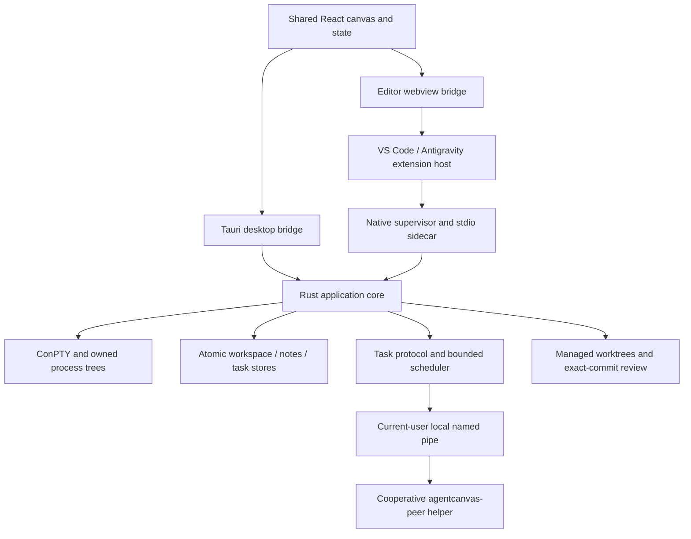

# Architecture

AgentCanvas has one shared React canvas and two current Windows hosts. Rust owns privileged process, workspace, task and Git behavior; the frontend renders state and sends validated requests.

## Source map

| Path                                    | Responsibility                                                                            |
| --------------------------------------- | ----------------------------------------------------------------------------------------- |
| `src/canvas/`, `src/ui/`                | World-coordinate canvas, geometry/history, shared controls and presentation.              |
| `src/terminal/`                         | xterm rendering and session lifecycle; renderer visibility does not own the process.      |
| `src/workspace/`, `src/notes/`          | Serialized saves, note drafts, conflict display and workspace switching.                  |
| `src/tasks/`, `src/team/`, `src/areas/` | Task/run/review UI and bounded frontend operations.                                       |
| `src/editor.ts`, `src/native.ts`        | Host boundary, renderer generations and frontend RPC.                                     |
| `extension/src/`                        | Editor integration, bounded stdio transport, checkpoints, recovery and restart control.   |
| `src-tauri/src/`                        | Native validation, process ownership, atomic files, IPC, task scheduler and Git journals. |
| `src-tauri/src/bin/`                    | Editor supervisor/worker, PTY host and cooperative helper executables.                    |
| `src-tauri/tests/`                      | Native lifecycle, isolation, transport and mixed-team fixtures.                           |
| `scripts/`, `.github/`                  | Build/package/audit tools and contribution/CI workflows.                                  |

## Rules that cross modules

1. Store world coordinates. Convert to screen coordinates only at viewport boundaries.
2. Keep layout undo separate from processes, permissions, tasks and Git operations. Undo never executes work.
3. Keep terminal processes alive while renderers detach; stop owned trees when the application/backend ends.
4. Validate privileged inputs in Rust. Never build shell command strings from input; use argument vectors.
5. Treat terminal bytes, peer text, notes, web pages and model proposals as untrusted. A connection is not coordinator authority.
6. Make persistence versioned, bounded, validated and atomic. Preserve corrupt originals/backups and refuse stale writes. Do not replay uncertain tasks after restart.
7. Bind reviews/checks to the exact commit and builder attempt. Worktrees are checkout isolation, not OS sandboxes.

## Editor recovery

The extension owns durable checkpoints separately from the renderer. A restart captures edits, writes a recovery file and confirms that the previous supervisor/job has no active descendants before replacement. It reconciles pending saves against disk, rejects stale generations and rebuilds a paused renderer. Conflicts retain drafts for recovery copies. Backend/renderer readiness is distinct from workspace readiness.

## Browser and provider boundaries

Desktop browser nodes own restricted embedded surfaces. Editor browser nodes explicitly open the default browser and do not provide embedded native surfaces. Neither is an agent browser-automation API.

Provider adapters launch separately installed CLIs; fixture success verifies local transport/scheduler behavior, not authenticated model cooperation. AgentCanvas adds no required account, telemetry or runtime CDN. Provider CLIs retain their own authentication, approval and network behavior.

Linux/macOS interfaces and packaging are planned in M13–M17. The present native implementation remains Windows-first; the existence of a portable Rust dependency is not proof of Unix support.
